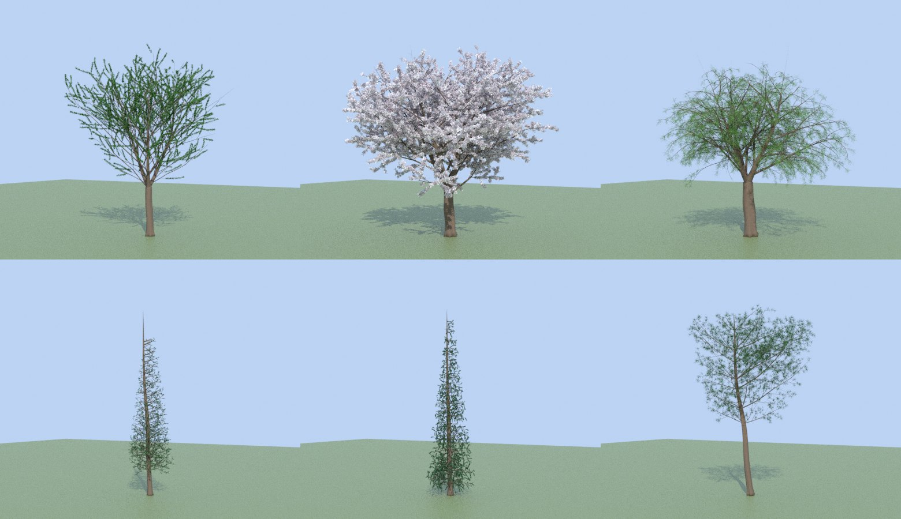
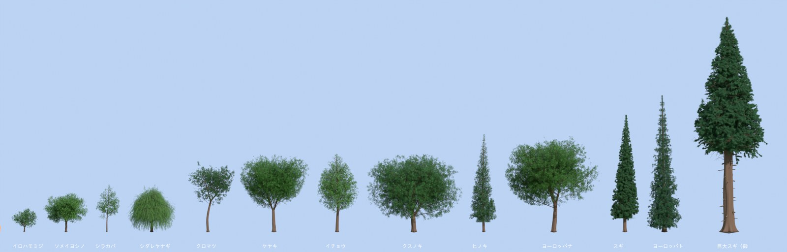
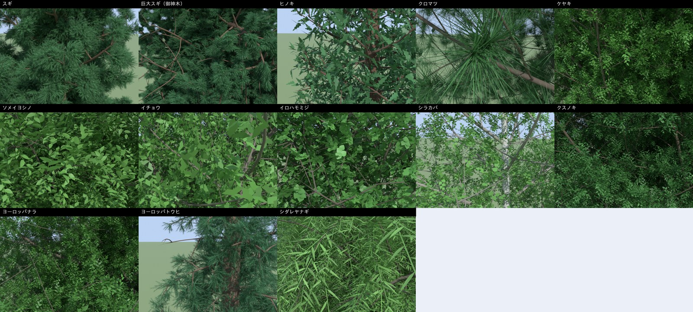
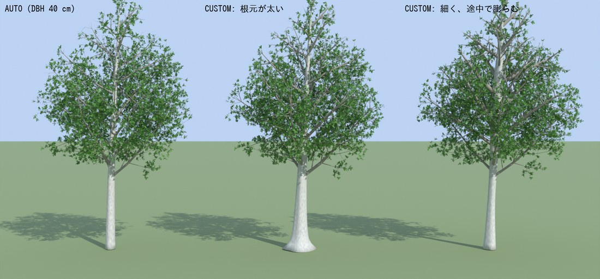
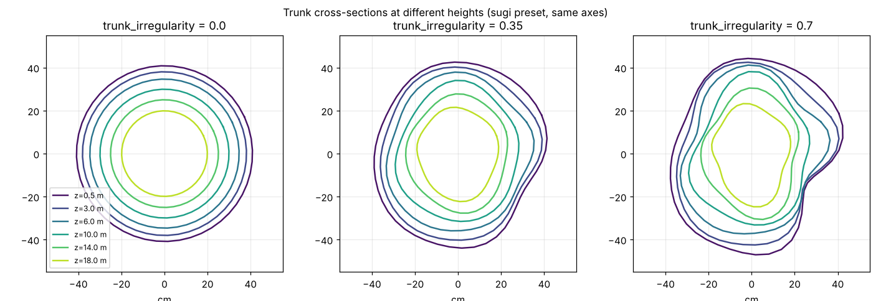
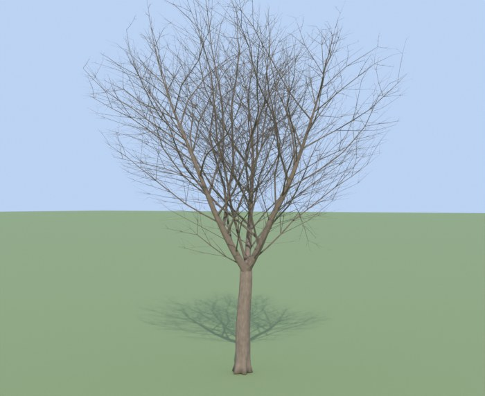
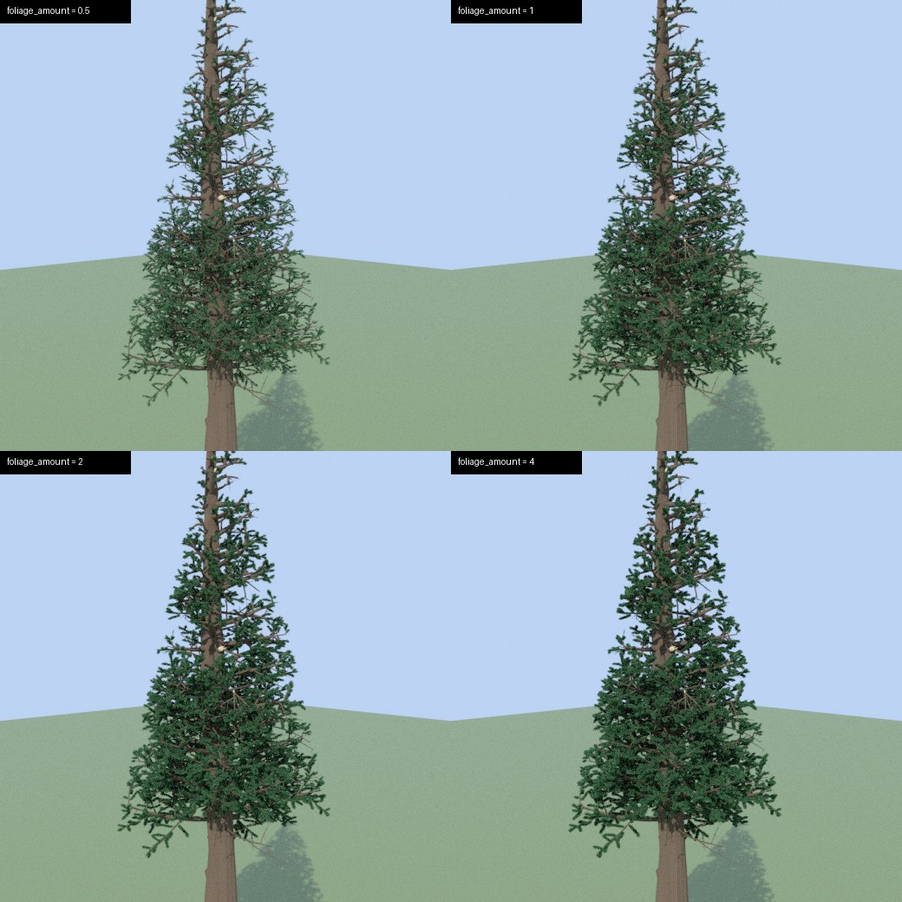
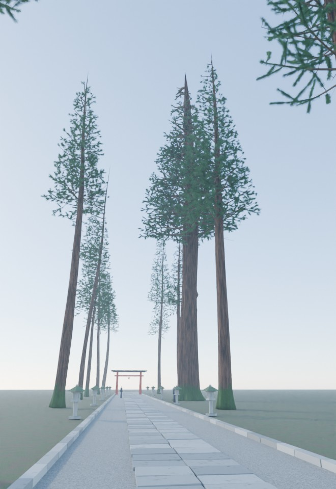

# TreeForge — 寸法指定でリアルな樹木を作る Blender 拡張機能

樹高・胸高直径・樹冠幅などの実測値から、幹・枝・葉を持つ木を生成します。
対象は **Blender 5.1.0 以降（`blender_version_max = "5.3.0"`）**。テストは 5.1.2 と 5.2.2 LTS で行っています。



13 樹種を 1 つの景色に並べた引き（大きさの比較。人の背丈の目線）と、樹冠に近づいた寄り（枝の分かれ方と葉の付き方。高品質）です。





骨格と幹・枝のメッシュは Python（numpy）で作り、葉・花は Geometry Nodes のインスタンスで置きます。
Geometry Nodes のモディファイア入力（`modifier["Socket_x"]` / `modifier.properties`）は一切使わないので、
5.2 で変わった API の影響を受けず、5.1 と 5.2 で同じコードが動きます。

## 追加した 3 つの要件

要件定義書にある機能に加えて、次の 3 つを入れています。

### 1. 幹の太さを「どの高さでどれだけ」で指定する



左: 自動（胸高直径 40 cm） / 中: 根元 150 cm → 急に細る / 右: 中ほどが膨らむ幹。枝はレオナルドの規則で幹との比から決まるので、幹を太くすれば枝も太くなります。

パネル「幹の太さ」で **自動 / 高さごとに指定** を切り替えます。

| 項目 | 意味 |
|---|---|
| 高さ比 | 地上高 ÷ 樹高（0 根元 〜 1 樹頂）。右隣に実際の高さ [m] を表示 |
| 直径 [cm] | その高さでの幹の直径 |

- 点の間は PCHIP（単調 3 次エルミート）で補間します。指定した点は必ず通り、点の間でオーバーシュートしません。
- 高さ比 0 の点が無ければ最初の点の太さを下へ延長、1 の点が無ければ樹頂の細さまで滑らかに細らせます。
- 点を並べ替える必要はありません（評価時に整列）。「胸高直径から初期化」で現在の自動曲線を 6 点に標本化できます。
- 根張り（`root_flare_*`）は、この曲線の上に重ねて掛かります。
- 幹が分かれる樹種（ケヤキなど）では、分かれ目までがこの曲線、その先の主枝はレオナルド則で分配されます。
- 保存するプリセット（JSON）にも点列が入ります。

### 2. 断面を正円にしない（高さごとに少しずつ歪む）



同じ軸・同じスケールで、高さ 0.5〜18 m の断面を重ねたものです。歪み 0 は正円、0.35（既定）で緩やかに歪み、0.7 で強く歪みます。

断面の半径を `r(φ, s) = r_設計 · F(φ, s)` とし、F を次の合成で作ります（`core/cross_section.py`）。

- 2〜6 次の調和項。振幅は軸に沿って滑らかに増減し、位相は高さとともにゆっくり回ります。楕円っぽい断面の向きが高さでねじれ、所々で角張ります。2 次（楕円）を強めに効かせています。
- 断面中心の偏心（軸からのずれ）。
- 幹だけ: 根張りの峰、こぶ、樹皮の縦筋（ジオメトリとして）。

各高さの断面の平均半径は設計値のままです（テストで確認。歪みで太さの指定が狂いません）。値は `trunk_irregularity` / `branch_irregularity`（0〜1）で、樹齢感 `age_factor` で増減します。乱数は seed で再現できます。

### 3. 折れた枝・枯れた枝



- **折れ枝** `broken_branch_ratio`: 枝が途中で折れ、先の枝ごと消えます。折れ口は健全だったときの太さのまま残り、最後のリングがささくれて前に飛び出し、中心が凹んだ蓋で閉じます。細い枝より太い枝（L1）が折れやすい重みです。
- **垂れ下がり折れ** `broken_hang_ratio`: 折れ枝のうち、折れ口でつながったまま先が垂れ下がるもの。折れ口はくびれ、先の子孫は枯れ枝になります。
- **頂部折れ** `top_break_height`: 単幹の木で主幹をその高さ比で折ります（0 で無効）。
- **枯れ枝** `dead_branch_ratio`: 形は残り、葉が付きません。子孫も枯れ枝になります。樹冠の下側の L1 の枝ほど枯れやすく（下端で最大 2 倍、上限 0.6）なっています。
- **枝下の枝痕（スタブ）** `trunk_stubs`（チェックボックス、既定オフ。巨大スギだけオン）と `trunk_stub_density`（本/m、既定 0.5）: オンのとき、樹冠より下の裸の幹に、枯れて折れた枝の根元を足します。「いびつさ・損傷」パネルの「枝下の枝痕を付ける」で切れます。幹の表面から 0.3〜1.5 m 突き出し、折れ口は健全だったときの太さのままです。他の枝の形・太さ・折れの乱数には触れません。
- 折れ口の面は **材質スロット 7（折れ口）** と、面属性 `tree_break` に入ります。スロット 7 に淡い木質色の材質を割り当てると、折れ口が白っぽく見えます。
- 折れ位置は `broken_pos_min` 〜 `broken_pos_max`（枝長に対する比）で指定できます。

## インストール

```
python tools/build_zip.py            # 開発版（デバッグ中）: dist/tree_forge-0.1.3+dev.<コミット数>.<コミット>.zip
python tools/build_zip.py --release  # リリース版（安定版）: dist/tree_forge-0.1.3+stable.zip（未コミットの変更があると作らない）
```

どのビルドか分かるよう、zip 内のバージョンに印が付きます（semver のビルドメタデータ。Ubuntu の LTS のような印）。
**`+stable` はリリース版**、**`+dev.…` はデバッグ中の開発版**（末尾の `.dirty` は未コミットの変更を含むビルド）です。パネルの下端にも「0.1.3 安定版（stable）」または「0.1.3+dev.93.d4453be 開発版」と出ます。
リポジトリ上のマニフェストは `0.1.3` のままです。リリースのコミットには `Release 0.1.3 (stable)` のメッセージと `v0.1.3-stable` のタグを付けます。

Blender の「プリファレンス → 拡張機能 → ディスクからインストール」でその zip を選びます。
Blender 本体があれば公式のコマンドでも作れます。

```
blender --command extension validate tree_forge
blender --command extension build --source-dir tree_forge --output-dir dist
```

3D ビューの N パネルに「TreeForge」が出ます。

## 使い方

1. 樹種を選び（ケヤキが既定）、樹高・樹冠幅・胸高直径を入れて **木を生成**。3D カーソルの位置に作られます。
2. 木を選んだ状態では **再生成**（メッシュだけ差し替え。モディファイア・材質割り当て・トランスフォームは保持）と **新規**（今の設定を引き継いで別の木）。
3. 「自動再生成」を入れると値の変更ごとに作り直します（高品質では無効）。
4. 「詳細モード」で全パラメータ（全体・幹・枝 L1〜L3・葉）が出ます。
5. 「プリセット・書き出し」: 保存・読込・JSON 書き出し、書き出し用に実体化（葉のインスタンスを実メッシュにした複製）。

季節 `season`: 0 冬 → 0.15 開花 → 0.3 新緑 → 0.85 紅葉 → 1 落葉。ソメイヨシノは開花時に葉の存在率 0。

### 葉の量



主パネルの **葉の量**（`foliage_amount`、0〜5、既定 1）で、葉・針の数をまとめて増減できます（巨大スギの樹冠で 0.5 / 1 / 2 / 4 倍）。
個数に上限（品質ごと）があるので、上限に達したら数の代わりに 1 枚あたりを大きくして（最大 2.5 倍）密度感を保ちます。
「さらに手前の枝まで」は、枝が 3 段ある標準・高品質のときだけ「一段手前」と差が出ます（プレビューでは同じ）。
なお、葉の量などを変えると葉の細かい並びは作り直されます（枝の形は変わりません）。量を比べるときは同じシードで見てください。

| 設定 | 効果 | 表示 |
|---|---|---|
| 葉の量 `foliage_amount` | 葉・針の数の倍率 | 主パネル |
| 葉の密度 `leaves_per_m` | 末端の枝 1 m あたりの数（樹種ごとの基準） | 「葉・花」 |
| 葉のまとまり `leaf_cluster` | 1 インスタンスに含める葉の数（葉つきの小枝・針の房） | 「葉・花」 |
| 葉の拡大率 `leaf_scale` | 葉・針・花の大きさ | 「葉・花」 |
| 葉を付ける枝 `leaf_reach` | 末端のみ / 一段手前の外側まで / さらに手前まで | 詳細モード |
| 葉の付き始め `leaf_start` | 末端の枝の付け根からどこから付けるか（-1 は自動: 針葉・鱗片葉 0.1、針葉束 0.5、他 0.2） | 詳細モード |
| 葉の最大数 `leaf_max_instances` | インスタンス数の上限（葉のまとまり 1 つを 1 と数える。花は上限の半分まで。0 は品質の上限）。多いほどメモリと描画時間が増える | 詳細モード |

全設定項目の一覧は次の 2 つにまとめています。どちらもコードとプリセットから自動生成します（`python tools/dump_params.py`。bpy が必要）。

- [docs/PARAMETERS.md](docs/PARAMETERS.md): 画面のどのパネルに何が出るか（条件つき）、パラメータ全 100 項目（内部名・単位・範囲・既定値・説明）、UI 専用の設定、ボタン、品質レベル、プリセットの書式、参道シーンのオプション。
- [docs/PRESET_VALUES.md](docs/PRESET_VALUES.md): 13 樹種の全項目の値（既定と違う値は太字）。

### 品質

| 品質 | 幹・枝の三角形 | 葉インスタンス | 生成時間（本環境での実測、ケヤキ） |
|---|---|---|---|
| プレビュー | ≤ 30k | ≤ 20k | 約 0.3 s |
| 標準 | ≤ 200k | ≤ 150k | 約 1 s |
| 高品質 | ≤ 1.2M | ≤ 1.5M | 約 4〜6 s（巨大スギは約 8 s）。Blender 上の実測は高速化前の 7.1 s のまま |

三角形の予算は、枝の「本数」を残すように使います。標準・プレビューでは細い枝ほど断面（リングの頂点数）と節の数を減らして 1 本あたりを軽くし、
標準では L1・L2 を全部と L3 を数千本、プレビューでは L2 の一部（大木で 3 割ほど）を残します。それでも上限を超える場合は、細い枝（L3 → L2）から間引きます。
間引いた枝の分の葉は、**枝を作らずに葉の点だけ足して**、高品質に近い量（標準で高品質の 0.6〜1.3 倍）にそろえます（`leaf_points.virtual_twig_points`）。
そのため標準・プレビューで寄って見ると、葉が細い枝から少し浮いて見えることがあります（高品質では葉は必ず枝に付きます）。高品質の出力はこの処理の影響を受けません。

### サイズを変えたとき

樹高を変えると、同じ木の相似形に近くなるよう、枝の本数（`l1_density`〜`l3_density`）を樹高比の逆数で、葉の密度（`leaves_per_m`）を樹高比で補正します。
基準は **基準の樹高 `ref_height_m`**（詳細モード「全体」）で、同梱プリセットには既定の樹高が入ります（0 で補正なし）。
これが無いと、大きい木ほど枝が増えて葉が過密に、小さい木は疎になります（×1.4 で葉の面積が約 4 倍、×0.7 で約 1/4）。
大きく（×1.4）すると、高品質でも三角形の予算で細い枝が減り、葉が疎に見える樹種（ケヤキ・クスノキ・ヨーロッパナラ・巨大スギ）があります。その場合は「葉の量」で調整してください。

### 樹種プリセット（13 種）

スギ、**巨大スギ（御神木）**、ヒノキ、クロマツ、ケヤキ、ソメイヨシノ、イチョウ、イロハモミジ、シラカバ、クスノキ、ヨーロッパナラ、ヨーロッパトウヒ、シダレヤナギ。
巨大スギは高さ 55 m・樹冠幅 20 m の円錐形・胸高直径 約 2.6 m で、太さプロファイル（根元 300 cm、ほぼ円筒で上へ細る）、枝下高 約 21 m、根張り 6 本、枯れ枝・折れ枝・枝下のスタブ（`trunk_stubs` オン・0.5 本/m）の多い老齢木です。
太い幹では、リングの頂点数を半径に応じて増やし（高品質で弧長 3 cm、最大 256）、樹皮の縦筋の本数を円周から決めます。
各 JSON（`tree_forge/presets/`）の `_src` に、値が図鑑・DB の記載値（M）か推定値（E）かを書いています。
**分枝角・頂芽優勢・重力屈性・垂れ・L2/L3 の値はすべて推定値**で、参照写真との比較調整が前提です。
`tools/make_presets.py` が元データで、実行すると JSON を再生成します。

針葉樹は実寸の針だと遠景で見えないため、同梱プリセットでは「葉の拡大率」`leaf_scale` を 3〜5.5 にしています（実寸にするには 1）。
同梱の簡易マテリアルの幹・枝の色は樹種ごとに違います（`bark_color` / `branch_color`。シラカバは白い幹、クロマツは灰黒色など。図鑑の記述からの推定値）。自分の材質を割り当てればそちらが優先されます。
スギ類の枝葉は、針をらせん状に付けた小枝が扇状に広がる「房」（`leaf_cluster` 4〜5）です。

#### 参道の巨大スギ（描画例）



```
python tools/build_sando_scene.py --view wide --out sando.png          # bpy モジュールで
blender -b --factory-startup --python tools/build_sando_scene.py -- --view crown --out crown.png
```

石畳・砂利・縁石・石灯籠・鳥居・杉並木・遠景の林・霧のシーンを作って Cycles で描きます（`--view wide|low|crown`、`--seed`、`--samples`、`--scale`、`--bg-trees`、`--forest`）。
木そのものの生成（HERO の巨大スギで約 8 秒）は速いですが、Cycles CPU での描画は 1 枚あたり 7〜10 分かかります（4 コア、72 サンプル、林 140 本。3 枚で約 27 分）。

御神木に足したものは個別に切れます（既定はすべて入り）。

| フラグ | 切るもの |
|---|---|
| `--no-shimenawa` / `--no-shide` | 注連縄 / 紙垂 |
| `--no-mound` / `--no-litter` | 根元の土盛り / 落ち葉 |
| `--no-bark-moss` | 幹の根元の苔 |
| `--no-stubs` | 枝下の枝痕（`trunk_stubs` をオフに） |
| `--no-extras` | 上の全部（アドオンが作る木だけになる） |

`--save-blend` で保存した .blend では、注連縄・紙垂・土盛り・落ち葉が `Hero_Extras` コレクションの下に項目ごとの子コレクション（`Hero_Shimenawa` など）で入るので、アウトライナーの目のアイコンでも切れます。
これらはアドオン本体の機能ではなく、シーンスクリプト（`tools/build_sando_scene.py`）が作るものです。

## マテリアル

- スロット順は固定: 0 幹 / 1 枝 / 2 小枝 / 3 葉 / 4 花 / 5 果実 / 6 根張り / 7 折れ口。面属性 `tree_part` も同じ区分（折れ口は `tree_break`）を持つので、スロットが崩れても復元できます。
- 未指定の部位は同梱の簡易マテリアルで埋まります。根張りは幹、小枝は枝の指定を流用します。
- **名前から自動割り当て**: マテリアル名のキーワード（`bark` `leaf` `枝` …）で照合。
- **フォルダから構築**: テクスチャのファイル名（`diff / albedo / basecolor`、`nor_gl / normal_dx`、`rough`、`arm`、`ao`、`disp / height`、`opacity`、`translucency` など）を判別して Principled BSDF を組みます。DirectX 法線は Normal Map ノードの `convention` を切り替えます。
- **.blend から取り込み**。
- 葉: 5.2 以降は Thin Wall、それ以前は Translucent BSDF を混ぜます（`Thin Wall` 入力の有無で判定）。

### シェーダ・風用の属性

| 属性 | 型 / ドメイン | 内容 |
|---|---|---|
| `tree_part` | INT / FACE | 0 幹 1 枝 2 小枝 6 根張り |
| `tree_break` | INT / FACE | 折れ口の面 |
| `tree_level` | INT / POINT | 0 幹 1〜3 枝レベル |
| `dist_root`, `dist_root_n` | FLOAT / POINT | 根元からの距離 [m]、最大値で正規化 |
| `branch_t`, `branch_phase`, `branch_id` | FLOAT / FLOAT / INT | 枝内位置、枝ごとの乱数位相、通し番号 |
| `branch_pivot` | FLOAT_VECTOR / POINT | 枝の付け根の座標 |
| `junction_blend` | FLOAT / POINT | 分岐部（子の付け根）で 1 → 0 |

樹皮の UV は、周方向のタイル数を整数に丸めます（継ぎ目が出ない）。タイル数が変わる節には UV の継ぎ目が入ります。

## 仕組み

```
Params ─ skeleton.build ─ radius ─ damage ─ budget/fit ─ tube_mesher ─→ 幹・枝メッシュ ┐
 (schema)  (階層分枝)     (パイプ    (折れ・     (三角形予算・   (リング・UV・属性)        ├→ Blender
                          モデル)    垂れ下がり)  幅の最終合わせ)   leaf_points ─────────→ 葉の点群 + GN ┘
```

- `core/` は bpy 非依存（numpy のみ）で、pytest で検証できます。`blender/` が Blender への書き込み、`props.py` が `schema.py` の表から PropertyGroup を生成します。
- 骨格: 樹冠エンベロープ（8 種）を「枝がまっすぐ伸びたときにエンベロープから出るまでの距離」として使い、重力屈性・光屈性・垂れ・くねり・頂芽優勢（低いほど屈曲）で曲げます。最後にエンベロープで刈り込み、樹高・樹冠幅に合わせます。
- 太さ: 各節に「その先が支える量」q を割り当て、半径を `q^(1/Δ)` に比例させます（Δ=レオナルド指数、既定 2）。幹は太さプロファイルで絶対値を与え、枝は親との比で決まります。
- 乱数はサブシステムごとのストリーム（骨格 / 葉 / 樹皮 / 損傷）です。葉の密度を変えても枝の形は変わりません。

## 要件定義書との差分

実装していないもの・変えたもの:

| 項目 | 状況 |
|---|---|
| Space Colonization（詳細モード）、光競合による剪定 | **未実装**。骨格は Weber–Penn 系の階層分枝 + エンベロープ刈り込みのみ（`algorithm`、`light_prune_threshold` は無い） |
| 風（`TG_Wind`、`add_wind`） | **未実装**。風用の属性だけ出力している |
| Asset Browser 連携 | **未実装**（.blend 取り込みで代替） |
| 果実 | スロットと属性区分だけ。ジオメトリは生成しない |
| 葉アトラス（`leaf_atlas_*`、`leaf_tile`）、LOD | **未実装** |
| 枝レベルごとの `segments` / `ring_verts` / `dead_branch_ratio` | 品質テーブルとグローバル値に変更 |
| 追加したもの | 幹の太さプロファイル、断面の歪み、折れ枝・頂部折れ、折れ口スロット(7)、`leaf_cluster`（葉つきの小枝）、`leaf_scale`、`radius_mode=RATIO` |
| 樹冠幅の定義 | xy 外接矩形の幅と奥行きの平均。損傷後に ×0.95〜1.05 の範囲で合わせ直すので、円錐形では −4% 程度残ることがある |

## テスト

```
python tests/run_all.py                                    # 単体 + (bpy があれば) Blender 結合
python -m pytest tests/unit -q                             # bpy 不要
python tests/blender/test_addon.py                         # bpy モジュールで
blender -b --factory-startup --python-exit-code 1 --python tests/blender/test_addon.py
```

- 単体（pytest）: スキーマ・プリセット・マニフェスト、テクスチャ名判別 38 ケース、PCHIP・エンベロープ・回転、レオナルド則（幹分かれで誤差 1% 以内、Δ=1.8〜3.0）、**太さプロファイルが骨格とメッシュの両方で指定直径になること**、**断面が正円でなく高さで変化すること**、**折れ口・垂れ下がり・頂部折れ・枝下スタブ**、13 樹種のメッシュ整合・予算・寸法、**葉の量・葉を付ける枝・付き始め・最大数**、太い幹のリング細密化、再現性、季節、HERO のケヤキ（15 秒以内・樹高と樹冠幅 ±5%）。
- Blender 結合: 生成・属性・材質スロット・GN インスタンスの評価・再生成での保持・プリセット往復・フォルダ構築・書き出し用実体化・複製した木の独立性・UI 描画コードの名前検証、参道シーンの飾り（注連縄など）の個別オン/オフ。5.1.2 と 5.2.2 LTS の両方。

## 既知の制限

- 描画はヘッドレスの Cycles（CPU）でしか見ていません。**EEVEE・ビューポート表示は未確認**で、葉の半透過・Thin Wall・インスタンス属性（`leaf_var`）の見え方は GUI で確認してください。
- `blender --command extension validate / build` は実行していません（この環境に Blender 本体が無いため）。代わりに zip を作り、5.1.2 と 5.2.2 で拡張機能としてインストール・有効化・生成・プリセット保存まで通しました。
- Blender 5.3 は未検証です（`blender_version_max` は要件のとおり 5.3.0）。
- FBX / glTF / USD への書き出しと再読込でのマテリアル数一致は未検証です。実体化した複製を作るところまでです。
- 樹種ごとのパラメータの大半は推定値で、実際の樹形との比較調整はしていません。
- 葉の形は汎用の 5 種類（広葉・鱗片葉・扇形・針の房・針の束）です。ナラの波状の縁やモミジの深い掌状裂、ヒノキの平たい枝葉は再現していません。
- 幹が分かれる木（ケヤキ・モミジなど）は、1 本の連続した主幹から少し細い大枝が別々の高さ・向きに順に出ていき、主幹も先へ行くほど細くなります（1 点では分かれません）。大枝が開く角度は「幹分かれの開き」（`trunk_split_spread_deg`、-1 で樹冠形に応じた自動）で変えられます。大枝が主幹から出る所は、メッシュ同士を滑らかに溶かす処理が未実装なので、ごく近くで見ると楕円状の継ぎ目が見えることがあります。
- 葉を付ける側枝（`leaf_shoots`）は点だけで、メッシュは作りません。標準・プレビューで枝を作らない分の葉（仮想の小枝）も、細い枝から少し浮いて見えることがあります（高品質では葉は必ず枝に付きます）。
- プレビューは葉の数の上限（2 万）が低く、上限に達した分は 1 枚を大きくして密度感を保つため、寄ると標準より葉が大きく見えます（針葉樹は笹のような平たい葉に見えます）。
- クロマツは幹が樹冠の中ほどで分かれる傘形に寄せていますが、実物のような、太くねじれた枝が作るパッド状の不整形な樹冠にはなりません。シダレヤナギは葉が小枝に沿って垂れる暖簾状ですが、樹冠の輪郭は丸みが強めです。
- 樹皮の質感（縦裂・剥離）は、同梱の簡易マテリアルでは色とノイズだけです。`bark_type` は記録のみで見た目に効きません。
- 木を削除しても、非表示のインスタンス元（`TG_Sources` コレクション内の子オブジェクト）はその木の子として残ります。階層ごと削除してください。

## ライセンス

GPL-3.0-or-later（`LICENSE`）。
